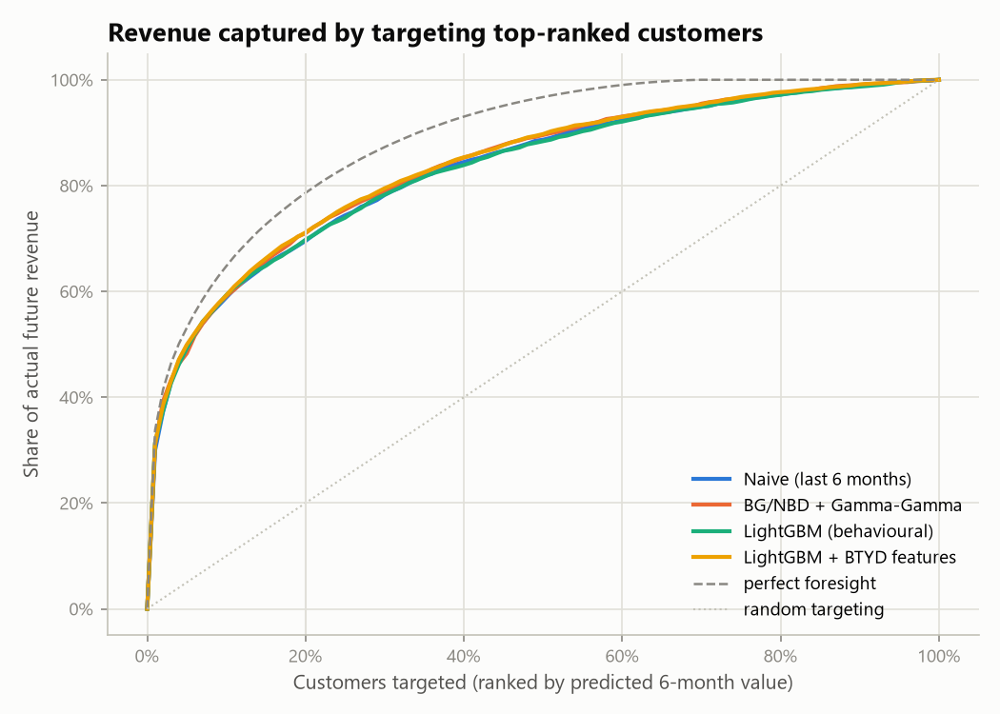
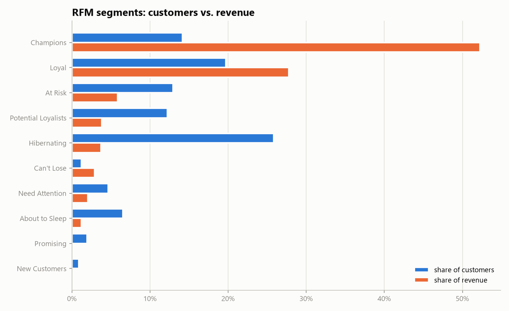
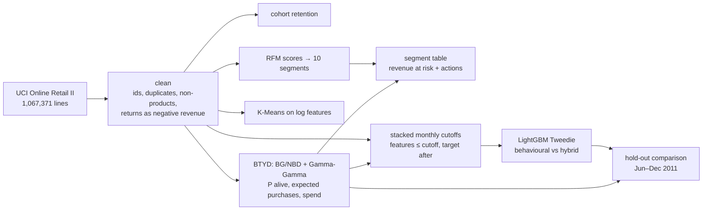
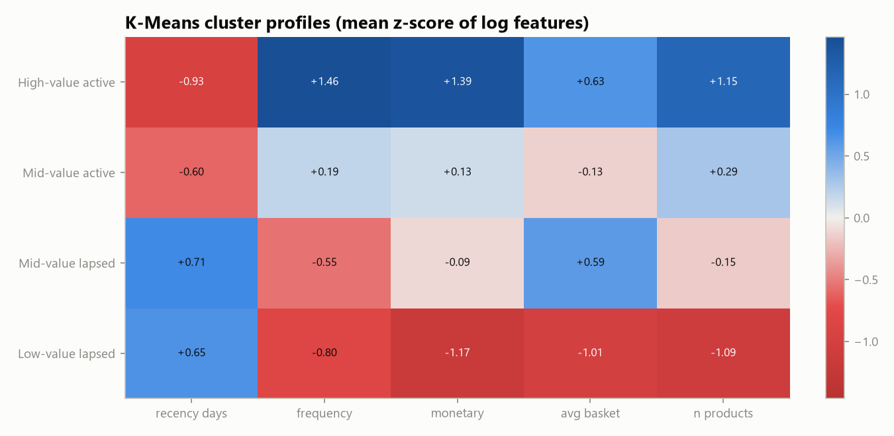
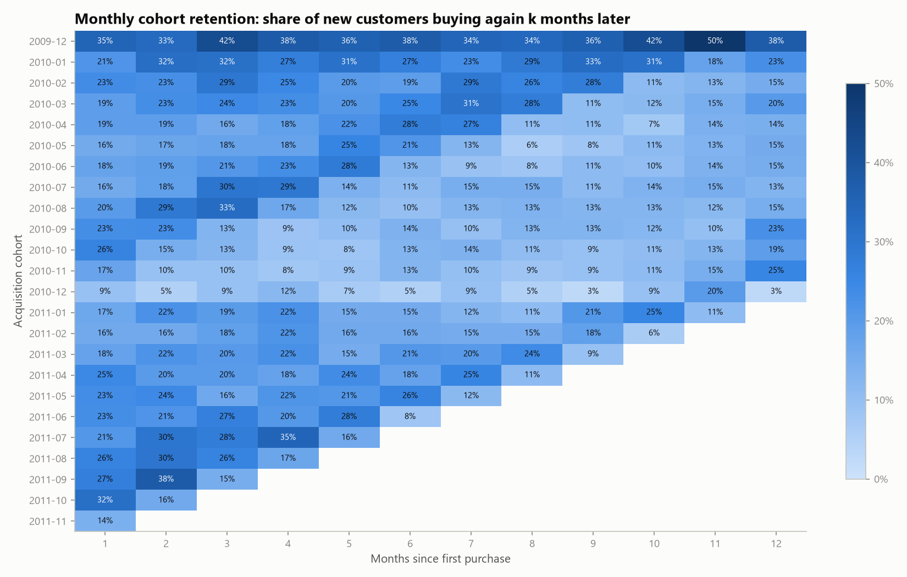

# Customer Segmentation & Lifetime Value — 1M+ E-commerce Transactions

[](https://github.com/mihribansoykan/customer-segmentation-clv/actions/workflows/ci.yml)


> 🇹🇷 **Türkçe özet:** Bir İngiliz e-ticaret şirketinin 2 yıllık, 1 milyonu aşkın satış kaydı temizlendi; müşteriler **RFM kuralları** ve **K-Means** ile segmentlere ayrıldı. Ardından müşterilerin önümüzdeki 6 aydaki harcaması (CLV) dört yöntemle tahmin edilip zamana dayalı, sızıntısız bir test döneminde karşılaştırıldı: basit kural, makalelerden sıfırdan kodlanan **BG/NBD + Gamma-Gamma** olasılıksal modeli, LightGBM ve hibrit model. Temel bulgular: müşterilerin %34'ü gelirin %80'ini getiriyor; kaybedilmek üzere olan değerli müşterilerde yaklaşık **£64 bin gelir risk altında**; 7 parametreli olasılıksal model de gradient boosting kadar iyi sıralama yapıyor ve toplam geliri çok daha doğru tahmin ediyor.

---

## Business questions

1. **Who are our customers?** Which groups drive revenue, and which need a different treatment?
2. **Who is slipping away, and how much revenue is at stake?**
3. **How much will each customer spend in the next 6 months?** The answer drives retention budgets and the size of win-back offers.

## Key results

| | |
|---|---|
| **Revenue concentration** | top 20 % of customers → **77 %** of net revenue (top 1 % → 31 %) |
| **Champions + Loyal (RFM)** | **34 %** of customers → **80 %** of revenue |
| **At Risk + Can't Lose** | 827 customers, £206k revenue last year, **≈ £64k expected to be lost** without action |
| **Retention** | only **~20 %** of new customers buy again the next month; December-2010 shoppers: 9 % |
| **Best CLV model** | BG/NBD + Gamma-Gamma: lowest error, best ranking (tied), total-revenue bias only **−8 %** |

### CLV model comparison (6-month hold-out, Jun → Dec 2011, 2,625 customers, £3.76M actual revenue)

| Model | MAE (£) ↓ | RMSE (£) ↓ | Spearman ↑ | Revenue captured by top 20 % ↑ | vs. perfect foresight | Total-revenue bias |
|---|---|---|---|---|---|---|
| Naive: next 6 m = last 6 m | 896 | 4,110 | 0.600 | 69.5 % | 88.4 % | −17.0 % |
| **BG/NBD + Gamma-Gamma** | **805** | **2,950** | **0.645** | 71.0 % | 90.3 % | **−7.9 %** |
| LightGBM (behavioural, Tweedie) | 866 | 3,979 | 0.601 | 69.8 % | 88.7 % | −18.9 % |
| LightGBM + BTYD features (hybrid) | 839 | 3,788 | **0.645** | **71.1 %** | **90.5 %** | −12.4 % |

**Takeaway:** a 7-parameter probabilistic model, [implemented here from the original papers](src/retail_clv/btyd.py), matches gradient boosting trained on 20k rows at ranking customers and beats it clearly at forecasting total revenue. The recommendation is to put BG/NBD + Gamma-Gamma into production (it is explainable, needs no labels and also gives P(alive)) and keep the hybrid model as a challenger.

<p align="center">
  
  
</p>

## Approach



**Data cleaning:** 243k lines without a customer id and 26k exact duplicates are removed, as are non-product codes (postage, fees, manual adjustments). **Cancellations are kept as negative revenue**, so value is measured net of returns. Every step is logged in [`metrics.json`](reports/metrics.json).

**Segmentation:**
- **RFM:** quintile scores and the classic R×F grid, giving 10 named segments, each with a recommended action ([`segment_summary.csv`](reports/segment_summary.csv)).
- **K-Means:** clustering on log-scaled recency, frequency, monetary value, basket size and product range. The silhouette score peaks at k = 2, but that only splits active from lapsed customers. **k = 4** adds a value dimension and keeps the silhouette flat (0.24), so it was chosen for actionability, and the choice is documented.

<p align="center"></p>

**CLV without leakage:**
- Features only use the 180 days before each cutoff.
- LightGBM trains on **7 stacked monthly cutoffs** (Jun–Dec 2010, 20,737 rows). Every training target ends on or before the test cutoff, and a calendar feature (share of the window that falls in Q4) handles seasonality.
- BTYD models are re-fitted at every cutoff using only past data.
- A unit test perturbs all post-cutoff transactions and asserts that the features do not change.

**Real-data edge cases handled:**
- Gamma-Gamma estimated `q < 1`, which means spend per order is so heavy-tailed (wholesalers) that the theoretical population mean is infinite. The model detects this and falls back to the empirical mean instead of returning negative values.
- BTYD summaries count purchases at any time on the cutoff day, not just up to midnight.

<p align="center"></p>

## Reproduce

Requires [uv](https://docs.astral.sh/uv/).

```bash
git clone https://github.com/mihribansoykan/customer-segmentation-clv.git
cd customer-segmentation-clv
uv sync                 # Python 3.12 environment from uv.lock
uv run retail-clv       # downloads data once (~45 MB), writes reports/ (~3 min on a laptop)
uv run pytest           # 29 tests, 95 % coverage, synthetic data, no network
```

Notebooks (rendered on GitHub):
1. [`01_data_cleaning_and_eda`](notebooks/01_data_cleaning_and_eda.ipynb): cleaning log, seasonality, concentration, cohorts
2. [`02_segmentation`](notebooks/02_segmentation.ipynb): RFM vs. K-Means, revenue at risk, actions
3. [`03_clv_prediction`](notebooks/03_clv_prediction.ipynb): model comparison, calibration by decile, parameters

## Project structure

```
├── src/retail_clv/
│   ├── data.py          # download (zip → parquet cache), cleaning with an audit log
│   ├── rfm.py           # RFM table, scores, segment rules and actions
│   ├── clustering.py    # K-Means, k selection, cluster naming and profiles
│   ├── cohorts.py       # monthly retention matrix
│   ├── btyd.py          # BG/NBD + Gamma-Gamma from scratch (scipy)
│   ├── clv.py           # leakage-safe features, stacked cutoffs, LightGBM, metrics
│   ├── plots.py         # report figures
│   └── pipeline.py      # end-to-end CLI: `uv run retail-clv`
├── notebooks/           # narrative analysis (executed, with outputs)
├── reports/             # metrics.json, CSV tables, figures
└── tests/               # 29 tests: parameter recovery, leakage guard, pipeline smoke test
```

## Limitations & next steps

- **BG/NBD assumes one-time buyers are still "alive"** (P(alive) = 1 until a repeat purchase), so revenue at risk for single-purchase segments is a lower bound. The MBG/NBD variant would fix this.
- Two years of data and a single hold-out season. A rolling multi-season backtest would make the comparison more robust.
- CLV is measured in revenue, not margin, and ignores customers acquired after the cutoff.
- **Next:** product-mix features (category embeddings), MBG/NBD, uplift modelling for win-back campaigns.

## Data & licence

Chen, D. (2019). *Online Retail II.* [UCI Machine Learning Repository, id 502](https://archive.ics.uci.edu/dataset/502/online+retail+ii), CC BY 4.0. Models follow Fader, Hardie & Lee (2005), *"Counting Your Customers the Easy Way"* and *"RFM and CLV: Using Iso-Value Curves"*. Code is released under the [MIT License](LICENSE).
